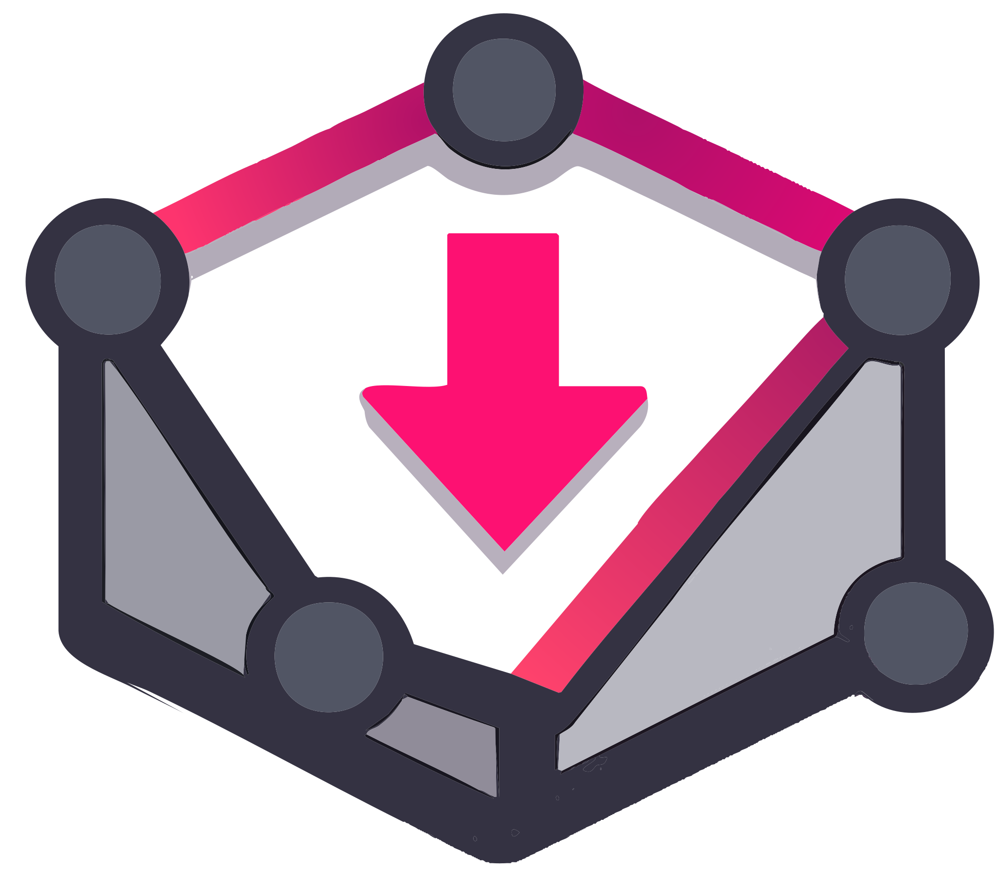
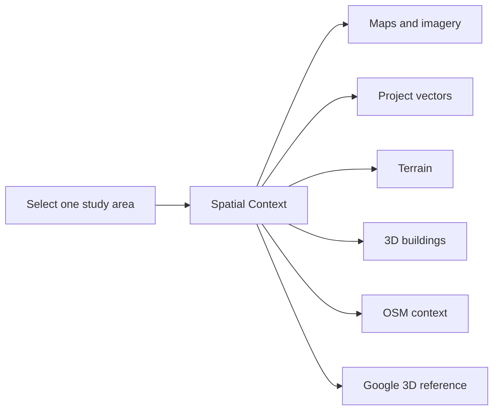

  

# RhinoSpatial

**Bring real site context into Rhino and Grasshopper.**

Choose a study area once, then add maps, terrain, buildings, imagery and project data in one aligned workspace. RhinoSpatial helps architects, urban designers and landscape architects assemble useful context for site analysis, concept design and early-stage studies.

The workflow stays familiar in Grasshopper: one `Spatial Context`, connected to the layers your project needs. Data is placed near Rhino's origin by default, so it remains practical to view and model. Projects that need original coordinates can use `Use Absolute Coordinates`.

[First workflow](docs/SHOWCASE.md) · [Working with project data](docs/WORKING_WITH_PROJECT_DATA.md) · [Examples](examples/README.md) · [Website](https://pascalnun.eu/tools/rhinospatial/) · [Releases](https://github.com/PascalNun/RhinoSpatial/releases)

## Install

RhinoSpatial runs in Rhino 8 and Grasshopper on macOS and Windows.

1. Open Rhino 8 and run `PackageManager`.
2. Search for `RhinoSpatial` and install it.
3. Restart Rhino or Grasshopper if requested.
4. Look for the `RhinoSpatial` tab in Grasshopper.

For manual installation, download the ZIP from [GitHub Releases](https://github.com/PascalNun/RhinoSpatial/releases) and follow the [installation guide](package/food4rhino/INSTALL.md). RhinoSpatial is also available on [Food4Rhino](https://www.food4rhino.com/en/app/rhinospatial?lang=en).

**The public release is 0.4.0.** The `main` branch contains newer compatibility work for the next release. Features described as **development** require a build from `main`; updating the repository does not update an installed plugin. See [what is available in each version](docs/WORKING_WITH_PROJECT_DATA.md#release-and-development-features).

## Start with one area

1. Place `Spatial Context` and connect a Button to `Open Map`.
2. Open the map and draw a small rectangle around your project.
3. Connect the same `Spatial Context` output to each source component.
4. Add one layer, check its result, then build up the rest of the study.

If you already have a supported service or project file, connect it to `Reference Source` before opening the map. RhinoSpatial uses its location and coordinate information to orient the map. The referenced data is loaded only when you connect it to a source component. A saved study area takes priority when you reopen the definition.

Try imagery with parcels for a site plan, terrain with buildings for a context model, or OSM for a quick figure-ground study. The [visual workflow](docs/SHOWCASE.md) walks through the components, and the [example definitions](examples/README.md) provide starting points you can adapt to your own project.

## Choose the layers you need

| What you need | Component | Typical sources |
| --- | --- | --- |
| A shared study area and placement | `Spatial Context` | Map selection, optionally oriented from a service or file |
| Parcels, boundaries, roads, planning layers or points | `Load WFS` | WFS, OGC API Features, Shapefile and GeoJSON; development also adds GeoPackage and direct downloads |
| Maps and orthophotos | `Load WMS` | WMS; development also adds WMTS tile services |
| Georeferenced project imagery | `Load GeoTIFF` | Local GeoTIFF; development also adds world-file imagery and remote COG windows |
| Ground and elevation | `Load Terrain` | WCS, local DEMs, ASCII Grid and regular XYZ/CSV grids; development also adds ATOM and COG elevation sources |
| 3D building and roof geometry | `Load LoD2 Buildings` | WFS, supported ATOM services, CityGML, CityJSON, folders and archives |
| Quick urban and landscape context | `Load OSM` | OpenStreetMap buildings, roads, water, green areas and rail |
| Photogrammetric visual comparison | `3D Tiles Viewer (Google)` | Temporary Google 3D reference using your own API key |

`List WFS Layers` and `List WMS Layers` help choose a layer from a service. In development, `List WFS Layers` also lists local GeoPackage feature layers. Component names remain familiar as the supported sources grow.

For help choosing a service, download or local file, read [Working with project data](docs/WORKING_WITH_PROJECT_DATA.md). Exact formats, inputs and limits are in the [Component and Source Reference](docs/COMPONENT_REFERENCE.md).

## Working with real project data

Use official or project-specific sources when accuracy and provenance matter. Built-in imagery and terrain fallbacks, along with OSM, can help you get oriented quickly. Their coverage, resolution and detail depend on the source.

Start with a small area and read the component's `Status` output if a layer is missing or takes longer than expected. Coordinate systems, available coverage and source formats can vary. RhinoSpatial reports unsupported data or placement rather than guessing where it belongs.

Google 3D Tiles are a visual reference viewer. They require your own Google Maps Platform setup and are not provided as editable, bakeable or exportable project data. See the [viewer guidance](docs/SHOWCASE.md#google-3d-tiles-reference) for setup and usage information.

## Documentation

The [documentation index](docs/README.md) brings the guides, component reference,
examples and project information together.

| Start here | Go deeper |
| --- | --- |
| [Visual workflow](docs/SHOWCASE.md) — build a study step by step | [Component reference](docs/COMPONENT_REFERENCE.md) — formats, inputs, placement and limits |
| [Working with project data](docs/WORKING_WITH_PROJECT_DATA.md) — choose sources and resolve common problems | [Test source catalogue](docs/TEST_SOURCES.md) — provider examples and recorded checks |
| [Grasshopper examples](examples/README.md) — reusable definitions and sample files | [Validation checklist](examples/VALIDATION.md) — checks before a release |
| [Installation](package/food4rhino/INSTALL.md) — Package Manager and manual setup | [Changelog](CHANGELOG.md) — released changes and work on `main` |

The [project scope](docs/PROJECT_SCOPE.md) explains the design principles. The [roadmap](docs/ROADMAP.md) records current priorities. Developers can find build instructions and documentation guidance in [Contributing](CONTRIBUTING.md).

## About the project

RhinoSpatial is created by **Pascal Nünninghoff** and released under the [MIT License](LICENSE). Bundled library licenses are recorded in [Third-Party Notices](THIRD-PARTY-NOTICES.md).

Bug reports, workflow feedback and small, shareable examples are welcome through [GitHub Issues](https://github.com/PascalNun/RhinoSpatial/issues).
